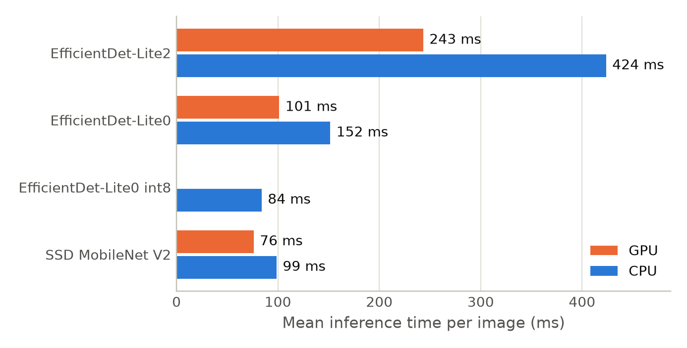
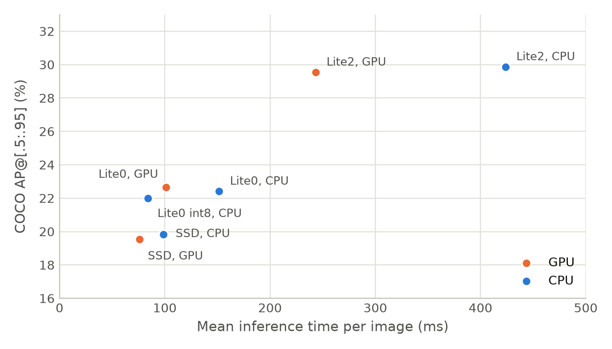
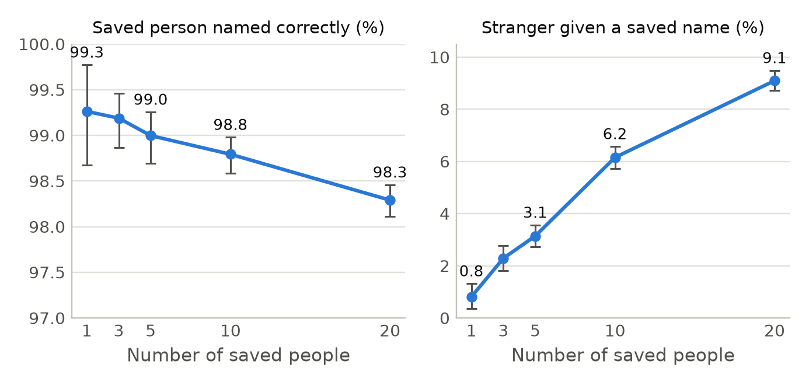
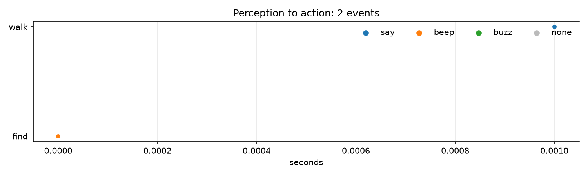

# Evaluation evidence

Measurements for the OpenCV AI Competition 2026 entry. Emulator numbers are the Android emulator (x86_64, no
GPU) on the development laptop and are slower than the phone; phone numbers name the phone.

## Colour (OpenCV over the whole region against the 24 x 24 grid sampler)

`CvColorParityTest`, 2026-10-18, emulator x86_64, 42 desk photos (`app/src/androidTest/assets/desks`), five fixed
boxes each (centre 50 % and the four quadrants' centre 50 %).

| | Grid sampler (old) | OpenCV 5 (new) |
|---|---|---|
| Pixels judged per box | 576 | every pixel of the box's centre half |
| Named the same colour | 207 of 210 boxes (99 %) | |
| Time per photo, light + 5 boxes | 6.0 ms | 7.6 ms |

The three disagreements were a red/brown split on a dark table edge and an orange/gray split on a mixed region:
cases where the 576 sampled points under-represented the region. Frame gains agreed within 0.05 on every photo
and darkness on every photo.

## Item mask (OpenCV clean-up of the segmenter's answer)

`CvMaskTest`, 2026-10-18, emulator x86_64, 10 desk photos x 3 touch points = 30 masks from `magic_touch`
through LiteRT. Clean-up: morphological open and close (3 x 3 ellipse), then only the connected component under
the touch point is kept.

| | Raw threshold (old) | OpenCV 5 (new) |
|---|---|---|
| Separate pieces per mask | 7.70 on average | 1 |
| Intersection over union with the raw mask | | 0.973 on average (worst 0.962) |
| Cover change | | at most 0.004 of the frame |
| Time per mask | | 5.7 ms |

The pieces removed were specks and thin bridges on the table, not the item: the cover barely moves while every
mask becomes one piece.

## Depth (OpenCV median filter before Walk reads floors and walls)

`CvDepthTest`, 2026-10-18, emulator x86_64, synthetic 160 x 90 depth images (no walk recordings were available
off the phone during the build phase).

| Input | Result after the 3 x 3 median |
|---|---|
| Flat floor at 1 500 mm with 5 % random spikes (300-6 000 mm) and 3 % holes | 99 % or more of measured pixels within 20 mm of the floor; every hole stays a hole |
| A step edge, 1 500 mm left, 2 500 mm right | no value between 1 600 and 2 400 mm: the edge stays sharp |
| All zeros (ARCore could not measure) | all zeros, no exception |

The filter never invents a measurement: a pixel ARCore left at 0 stays 0. The raw frame still goes to the
debug recorder, so a replay can compare both.

## Cloud ("look closer" round trip)

Pending: `cloud/tests/latency.py <function url> <key>` prints the table below once the Lambda is deployed
(Task 8 of the plan, waiting for the AWS account). Measured so far, on the emulator with the network off:
"look closer" answers "No internet. Nungil keeps working offline." within the 1.5 s connect timeout, and the
decision trace records `offline` (`LookCloserTest`, 2026-10-18).

| Photo | Round trip (ms) | In the Lambda (ms) | Answer |
|---|---|---|---|
| (to be filled by latency.py) | | | |

## Detectors (unchanged by this entry; the perception layer the OpenCV steps feed)

Infinix X6880 (MT6789), 1 000 COCO val2017 images, measured on the phone (2026-10, `DeviceBench`). AP is COCO
AP@[.5:.95] at the deployed settings (detector score 0.3, 10 results); precision and recall at the app's
defaults (0.7, people 0.5), IoU 0.5, bootstrap intervals over images. Latency leaves out the first 20 frames.

| Model | Delegate | AP | AP50 | Precision | Recall | Latency ms mean / median / p95 | FPS |
|---|---|---|---|---|---|---|---|
| efficientdet-lite0 | CPU | 22.4 | 33.6 | 96.0 % | 17.0 % | 152 / 151 / 169 | 6.6 |
| efficientdet-lite0 | GPU | 22.7 | 34.3 | 95.8 % | 17.0 % | 101 / 99 / 118 | 9.9 |
| efficientdet-lite0-int8 | CPU | 22.0 | 33.8 | 95.8 % | 16.7 % | 84 / 83 / 101 | 11.9 |
| efficientdet-lite2 | CPU | 29.9 | 43.1 | 95.5 % | 22.7 % | 424 / 421 / 443 | 2.4 |
| efficientdet-lite2 | GPU | 29.5 | 42.9 | 95.3 % | 22.6 % | 243 / 240 / 274 | 4.1 |
| ssd-mobilenet-v2 | CPU | 19.8 | 30.2 | 95.7 % | 14.3 % | 99 / 98 / 115 | 10.1 |
| ssd-mobilenet-v2 | GPU | 19.5 | 30.0 | 96.2 % | 14.0 % | 76 / 74 / 91 | 13.1 |

 

## Faces (unchanged by this entry)

LFW, 13 233 images, on the phone. Face found / passes the quality gate / embedded: 100.0 % / 97.9 % / 97.9 %.
Verification on 6 000 pairs at the app's threshold 0.5: 95.5 % accuracy, true accept 91.3 % [90.2, 92.2],
false accept 0.4 % [0.2, 0.7]; standard 10-fold protocol 96.32 % +- 0.58. Time per face: find 33 ms + embed 86 ms
(medians).

Open-set identification with the app's rule (5 samples per saved person, 300 random trials per row):

| Saved people | Saved person named correctly | Given another saved name | Stranger given a saved name |
|---|---|---|---|
| 1 | 99.3 % | 0.0 % | 0.8 % |
| 5 | 99.0 % | 0.0 % | 3.1 % |
| 10 | 98.8 % | 0.0 % | 6.2 % |
| 20 | 98.3 % | 0.0 % | 9.1 % |

## Agentic loop: perception -> decision -> action

Nungil's Find and Walk modes are closed loops: what the camera (and, in Walk, ARCore depth) shows changes the
next thing the user hears or feels, every frame.

| Mode | Seen | Decision | Action |
|---|---|---|---|
| Find | the target's box (detector, saved face or saved object), or nothing | zone left/ahead/right; beep interval from how far the target is from the centre; "lost" after 3 s without it | beep rate, a buzz when the target enters the centre, "Lost it" |
| Walk | depth grid (OpenCV-filtered), floor profile, hazards, signs, codes | wall/step/stairs/drop readings confirmed over several frames and while walking; hazard confirmed in 3 of 5 frames | "Wall ahead, 3 steps", beeps and vibration by closeness; never "safe" |
| Look closer | one frame, online | not set up / offline / answered / failed | the cloud's two sentences, or why not |

Every step is written to `files/trace/<date>.jsonl` by `DecisionTrace` as `{at, mode, seen, decision, action}`;
`tools/trace/plot.py` draws it. The figure below is the test trace from the emulator (two events); a real Find and
Walk trace is recorded on the phone for the final report.

Failure handling the user hears: "Lost it" after 3 s without the target; Walk says "could not measure" when depth
is empty and never says "safe"; "look closer" says "No internet" or "The cloud did not answer" and the phone keeps
working offline. Human control: "Eye stop" / "눈길아 그만" stops speech and beeps at once; every mode is left by
voice or by the one big button; nothing is sent to the cloud unless the user asks.

## Known limitations

- Depth on a plain floor still wobbles after the median; steps under about 10 cm and stairs seen from far away
  are confirmed late or not at all.
- Colour under strongly coloured light (a red lamp) is named after the light; the gray-world balance is clamped
  to 0.6-1.6 and cannot undo it.
- The mask clean-up keeps one component: an item in two visible parts (a cup behind a bottle) keeps the touched
  part only.
- "Look closer" needs a network and a key, costs a round trip of seconds, and the model may misread small or
  curved text; its answer is spoken as the model's, not as fact.
- Detector recall at the app's confidence is low by design (precision first: a wrong object is worse than a
  missed one for this user), and small objects are mostly missed.

## Responsible use

- No image leaves the phone unless the user says "look closer"; the Lambda stores nothing and logs only sizes
  and times. Faces and saved objects are embeddings on the phone, never uploaded.
- The cloud prompt forbids guessing who a person is; the on-device face recogniser names only people the user
  saved, and says "I don't know this person" otherwise.
- Nungil assists; it is not a mobility aid replacement. Walk mode never says "safe" and is tested with a sighted
  tester; a blind user's trial is still to be done.
- The entry's test photos are freely licensed (Wikimedia Commons); the face test photos are git-ignored.

## Video soak (the OpenCV paths frame after frame)

`CvSoakTest`, 2026-10-18, emulator x86_64: a 1 050-frame 640 x 480 video made from the desk photos
(`tools/desk-photos/make_video.sh`, slow zoom over each photo). Every frame runs the colour path (frame light and
three boxes), every tenth frame the segmenter and the mask clean-up.

| | Early (frames 10-110) | Late (last 100) |
|---|---|---|
| Colour path per frame | 4.6 ms | 3.8 ms |
| Native heap after GC | 116 MB (at frame 100) | 65 MB (at the end) |
| Java heap after GC | 15 MB | 13 MB |

3 150 of 3 150 boxes were named, 103 of 105 masks were cut. No growth in either heap and no drift in the frame
time: the Mats are released, not leaked.
