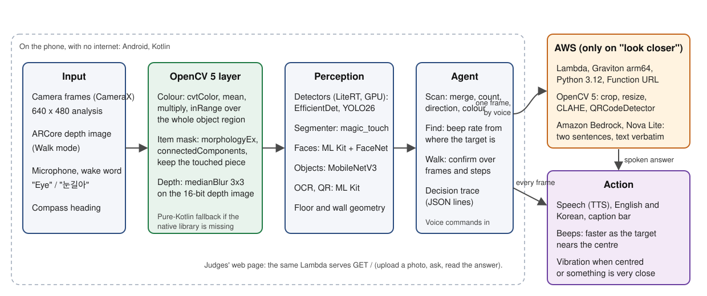

# Nungil: technical report for the OpenCV AI Competition 2026, powered by AWS

Repository: https://github.com/androidIkrom/nungil-opencv (AGPL-3.0). Measurements: `evaluation.md` in this
folder. Diagram: `architecture.svg`.

## 1. Problem

A blind or low-vision person entering a room, a corridor or a street has no quick way to learn what is around
them: what each thing is, which way it is, what colour it is, whether the floor ahead drops or rises. Screen
readers describe apps, not rooms. Cloud describers need a connection, a tap and several seconds, and they guess.

Nungil (눈길, "the way the eyes go") is an Android app that answers by voice while the user holds the phone upright
and turns or walks. It runs on the phone with no internet, in English and Korean, and it speaks plainly: counts
are the most seen in one frame, never a sum; directions come from the compass and the camera's field of view;
Walk mode never says "safe".

## 2. Who it serves

Blind and low-vision users who already use a phone with TalkBack; secondarily, anyone who cannot look at the
screen (hands and eyes busy). The design follows Korean accessibility practice: one big bottom button, 64 dp
targets, a caption bar that shows everything spoken, three themes checked for contrast.

## 3. Architecture

Input (camera frames at 640 x 480, ARCore depth, the microphone, the compass) flows through an OpenCV 5 layer
into perception (LiteRT detectors and segmenter on the GPU, ML Kit faces, OCR and codes, floor and wall
geometry), then into the agent policies (Scan, Find, Walk) that decide what the user hears or feels. One voice
command, "look closer", sends a single frame to AWS; everything else is on the phone.

Code map: `com.nungil.cv` (every OpenCV call, each with a pure-Kotlin fallback), `com.nungil.core` (pure,
JVM-tested policies and phrases), `com.nungil.scan`, `items`, `people`, `reader`, `walk`, `search` (screens),
`com.nungil.cloud` and `cloud/` (the Lambda), `com.nungil.trace` (the decision trace).

## 4. OpenCV 5 usage

OpenCV 5.0.0.1 from Maven Central (`org.opencv:opencv:5.0.0.1`), loaded with `OpenCVLoader.initLocal()`. Three
steps of the on-device pipeline run in OpenCV; each had a hand-written version before, which stays as the fallback
and as the reference in the tests.

**Colour of detected objects** (`CvColor`). The frame's gray-world gains come from `Core.mean` on the RGB frame
and the darkness test from the mean V after `cvtColor(RGB2HSV)`. For each detected object, the centre half of its
box is multiplied by the gains (`Core.multiply`), converted to HSV, and counted with one `Core.inRange` per colour
band; the 11 colour names are the old HSV rules written as boxes in 8-bit HSV (`ColorBands`), proven equal to the
old rules on a 1.3-million-point grid of HSV values (`ColorBandsTest`). Pixels that are white, gray or black as
shot keep their name, as before. Result (`evaluation.md`, Colour): the same name as the 24 x 24 grid sampler on
207 of 210 regions (99 %) over 42 desk photos, judging every pixel instead of 576; 7.6 ms against 6.0 ms per
photo on the emulator.

**Item outlines** (`CvMask`). The interactive segmenter (`magic_touch` through LiteRT) returns a confidence map
for the point the user touched. It is thresholded as before, then opened and closed with a 3 x 3 ellipse
(`Imgproc.morphologyEx`), labelled (`connectedComponentsWithStats`), and only the component under the touched
pixel is kept (the largest one if the opening removed the touched speck). Result: 30 masks from 10 desk photos
went from 7.7 pieces each to one, with intersection-over-union 0.973 against the raw mask (worst 0.962) and the
cover moved by at most 0.004 of the frame; 5.7 ms per mask.

**Walk-mode depth** (`CvDepth`). ARCore's 16-bit depth image passes through `Imgproc.medianBlur` (3 x 3) before
the floor profile and wall logic read it. Pixels ARCore left at 0 (unmeasured) stay 0: the filter never invents
depth. On synthetic images: 99 % or more of a flat floor's pixels within 20 mm after 5 % spikes; a 1 500 / 2 500
mm step edge stays sharp (no value between 1 600 and 2 400); an all-zero image stays all zero.

On the phone, in Find with the target in sight, "look closer" uploads the target box grown by 15 % of its own size
instead of the whole frame (`CloudCrop`, `CloudFrame`): on a 480 x 640 frame the upload fell from 66 774 to
16 032 bytes (`CloudFrameTest`), and the trace records which part went. In the cloud, OpenCV 5
(`opencv-python-headless 5.0.0.93`) crops by the same rule when a client sends a whole frame and a box (the web
page, other clients), resizes to a 1 280 px long side (`INTER_AREA`), applies CLAHE on the L channel when the mean
L is under 90, and reads any QR code with `QRCodeDetector` so the model is told its text verbatim
(`cloud/app/prep.py`, 9 tests).

## 5. AWS deployment

One Lambda function (`nungil-look`, Python 3.12, `arm64` on AWS Graviton, 1 024 MB, 30 s) behind a Lambda
Function URL, with a layer carrying OpenCV and NumPy for `manylinux2014_aarch64`. `POST /look` takes
`{image, question, lang, box}` with a shared key in the `x-nungil-key` header and returns `{answer, qr, ms,
model}`; `GET /` serves the judges' page. The function calls Amazon Bedrock (Converse API, `amazon.nova-lite-v1:0`
by default) with a system prompt that fixes the behaviour: at most two sentences, spatial words, text read
verbatim, never a guess about who a person is, "I cannot tell" when unsure, in the user's language. CloudWatch
Logs get one line per request (status, time, size); no image is stored or logged. IAM: the basic execution role
plus `bedrock:InvokeModel`.

Cost: Nova Lite is priced per token; one frame at 1 280 px and a two-sentence answer is well under a cent, and a
1 024 MB arm64 Lambda second is a fraction of a cent, so a thousand "look closer" calls cost on the order of one
US dollar. The phone sends nothing unless the user asks.

Deployment is one script, `cloud/deploy.sh` (AWS CLI v2); `cloud/smoke.sh` and `cloud/tests/latency.py` check the
live endpoint. (Status at the time of writing: the Lambda code has 23 passing local tests against a fake Bedrock
client; the deployment and its latency table are filled in once the account is ready. The app's offline and
not-set-up paths are verified on the emulator.)

## 6. Agentic loop

Nungil's Find and Walk modes are perception-to-action loops where what the camera shows changes the next action
on every frame (see `evaluation.md`, "Agentic loop"): in Find, the target's place sets the beep interval, a buzz
marks the centre, and three seconds without it says "Lost it"; in Walk, floor changes and hazards are confirmed
over several frames and while the user walks, then spoken by closeness. A decision trace (`DecisionTrace`,
JSON lines of `{at, mode, seen, decision, action}`) records every step for Find, Walk and "look closer";
`tools/trace/plot.py` draws it. Human control: "Eye stop" silences everything at once; nothing goes online unless
asked. Failure handling: "Lost it", "could not measure", "No internet", "The cloud did not answer".

## 7. Evaluation

See `evaluation.md` for the tables: colour parity (99 % agreement, 42 photos), mask clean-up (7.7 pieces to 1,
IoU 0.973), depth filter (synthetic), cloud round trip (pending deployment), and the unchanged perception layer
measured on the phone earlier in the build phase: seven detector configurations on 1 000 COCO images (for
example EfficientDet-Lite2 on the GPU: AP 29.5, precision 95.3 % at the app's threshold, 240 ms median) and face
recognition on LFW (verification 96.3 % 10-fold; open-set identification names a saved person correctly 98.8 %
of the time with 10 people saved, strangers get a saved name 6.2 %).

## 8. Limitations

Depth wobble remains for steps under about 10 cm; colour under strongly coloured light follows the light; the
mask clean-up keeps one piece, so an item split by an occluder keeps the touched part; "look closer" needs a
network and a key and may misread small text; detector recall is low by design (precision first). A blind user's
trial of Walk mode has not been done yet.

## 9. Responsible use

No image leaves the phone unless the user says "look closer", and the Lambda stores nothing. Faces and objects
are embeddings on the phone. The cloud prompt forbids guessing identities; the on-device recogniser names only
people the user saved. Nungil assists and does not replace a cane or a guide; Walk mode never says "safe". Test
photos are freely licensed; face test photos are not in the repository.

## 10. Reproduce

Build: Android Studio or `./gradlew assembleDebug` with `JAVA_HOME` at a JDK 17 or newer (models download at build
time; `-PskipModels` skips that for unit tests). Unit tests: `./gradlew testDebugUnitTest -PskipModels`
(1 055 tests). Emulator tests of the OpenCV steps: build `assembleDebug assembleDebugAndroidTest`, install both
APKs, then `adb shell am instrument -w -e class com.nungil.cv.CvColorParityTest com.nungil.test/androidx.test.runner.AndroidJUnitRunner`
(also `CvMaskTest`, `CvDepthTest`, `com.nungil.trace.DecisionTraceTest`, `com.nungil.scan.LookCloserTest`). Cloud
tests: `cloud/README.md`. Deploy: `cloud/deploy.sh`. Judge access: the Function URL and key in the Devpost testing
notes.
